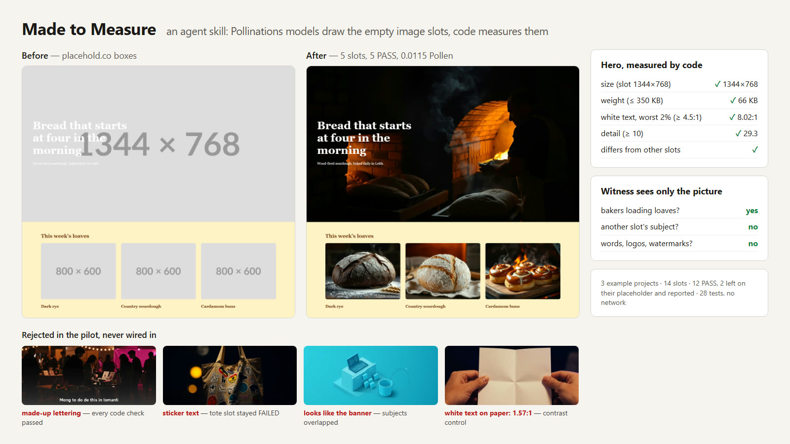
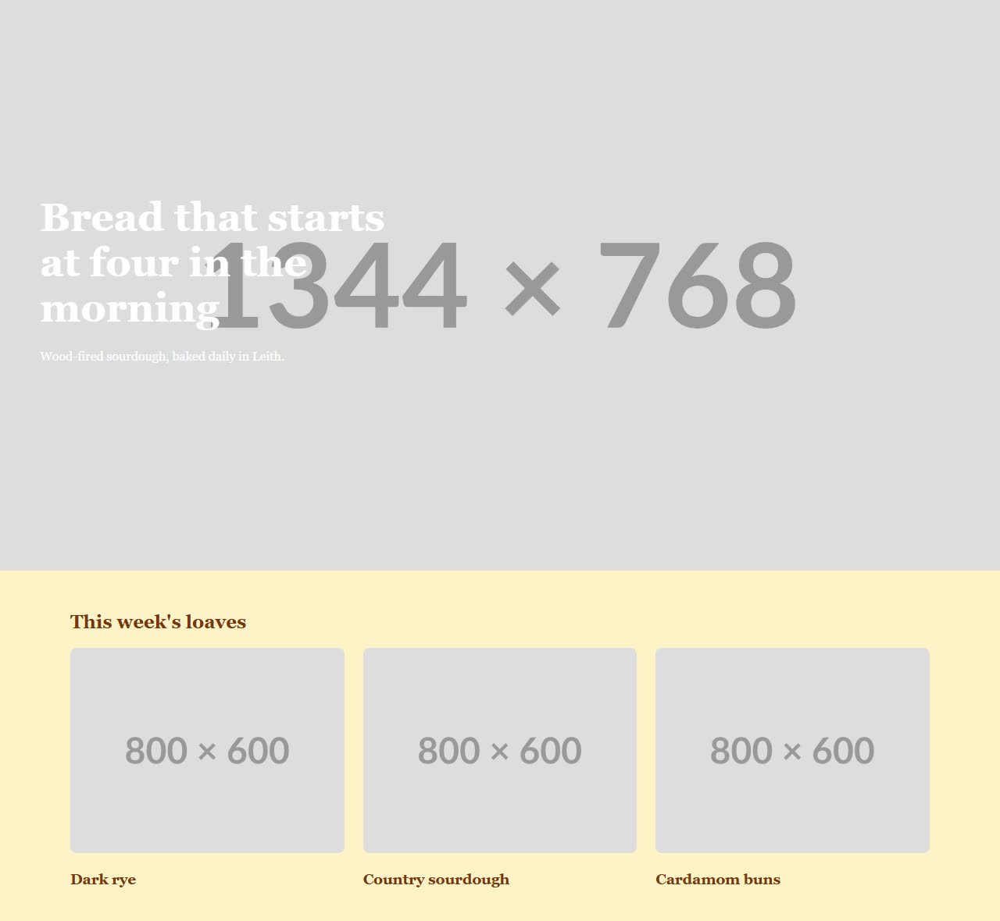
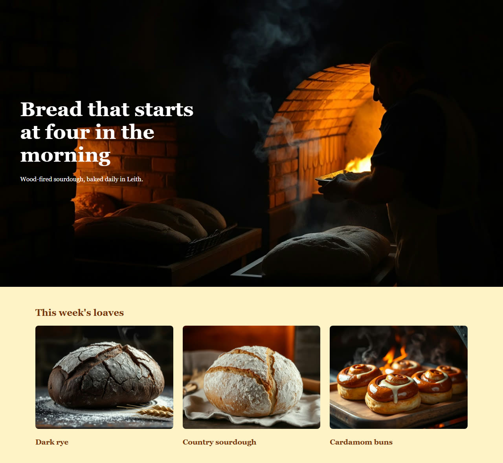
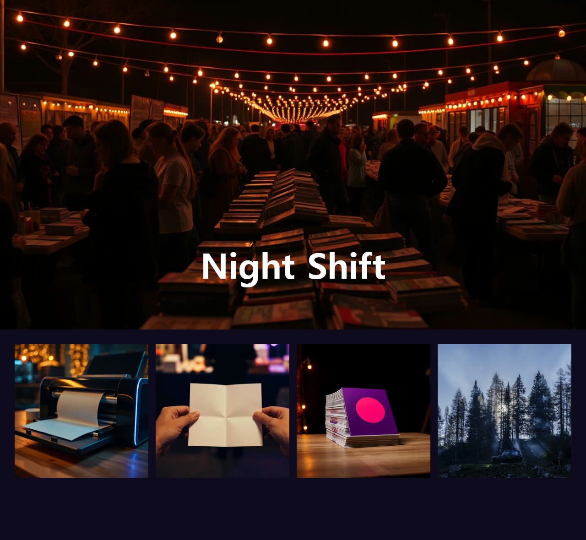
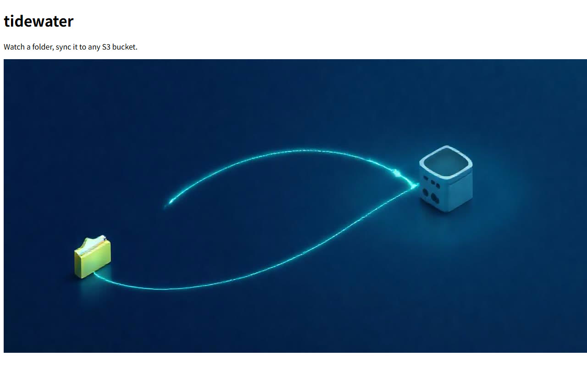

# Made to Measure

[](https://pollinations.ai/?ref=badge)

An agent skill for Claude Code, Codex and other coding agents. Your agent finds
the empty image slots in a project (placeholder URLs, image files that do not
exist, pages without a social card), Pollinations models draw them, and plain
code measures every picture against what the slot needs before it is wired in.

The skill is in [`skills/made-to-measure/SKILL.md`](skills/made-to-measure/SKILL.md).



## Install

**Claude Code**

```
/plugin marketplace add patbing/made-to-measure
/plugin install made-to-measure@made-to-measure
```

**Codex, or any agent that reads Agent Skills:** copy `skills/made-to-measure/`
into the agent's skills folder (for Codex, `~/.codex/skills/`).

**What it needs:** Node.js 18+, ffmpeg and ffprobe on PATH, and the Pollinations
CLI signed in (`npm i -g @pollinations/cli`, then `polli auth login`) or
`POLLINATIONS_API_KEY`. No npm dependencies.

Then ask your agent: *"Replace the placeholder images on this page"*, *"make an
OG card for the docs"* or *"this README needs a banner"*.

## Try one picture

```
node skills/made-to-measure/scripts/fit.mjs one "a lighthouse in fog" --size 1200x630 --text-zone left --text-color "#ffffff"
```

Draws, crops to exactly 1200×630, measures, repairs if needed, and writes the
picture and its report to the current folder.

## How it works

1. **Scan** finds the slots, with file, line, size and alt text, into `.made-to-measure/plan.json`.
2. **The agent corrects the plan from the code**: real sizes, where the file should live, and where page text sits on the picture.
3. **Plan**: a text model writes one art direction and a prompt per slot. The script prints the cost before anything is drawn.
4. **Make**: draw, crop to the exact size, measure, repair up to twice (the measured failures go back to the text model; the last try uses a second image model).
5. **The agent wires in** only what passed. `verify` rescans and re-measures everything on disk.

## What code measures

| Check | How | Passes when |
|---|---|---|
| size | ffprobe on the final file | exactly the slot size, upscaled at most 2× |
| weight | bytes after a JPEG quality ladder | at most 350 KB (or the slot's limit) |
| detail | luminance spread at 64×64 | at least 10, so not blank or flat |
| contrast | every text-zone pixel against the text colour, WCAG formula | the worst 2% still reach 4.5:1 (3:1 for large text) |
| distinct | 64-bit difference hash | differs from every other slot |
| witness | a second model sees only the picture: is it this subject, is it another slot's subject, is there text? | yes, no, no |
| palette | Lab hue of colourful pixels | a note in the report, never blocks |

When only contrast fails, the report gives the smallest overlay opacity that
passes (`PASS WITH SCRIM`). Pictures that fail keep their placeholder and the
report says why. Formulas and reasons: [`references/checks.md`](skills/made-to-measure/references/checks.md).

## Three example projects

Fictional brands, run for real. Each folder has `before/`, `after/`, page
screenshots, the agent's [`session.md`](examples/zine/session.md), and
`after/.made-to-measure/` with the plan, the report, the receipt and every attempt.

| Project | Slots | Result | Pollen |
|---|---|---|---|
| [bakery](examples/bakery) — light landing page, headline over the hero | 5 | 5 PASS, all on the first try | 0.0115 |
| [devtool](examples/devtool) — README banner, empty-state picture, docs OG card | 3 | 2 PASS, og FAILED (its subject overlapped the banner's) | 0.0372 |
| [zine](examples/zine) — dark event page, white title over the hero | 6 | 5 PASS, tote FAILED (lettering on the stickers in 5 of 6 tries) | 0.0632 |

| bakery before | bakery after |
|---|---|
|  |  |

| zine after (the tote slot kept its picsum placeholder) | devtool docs after |
|---|---|
|  |  |

## Controls: it rejects what it should

[`examples/controls/controls.json`](examples/controls/controls.json) holds ten
pictures that must not pass. `tests/controls.test.mjs` checks every one of them
without network:

- **Code controls (5):** white text moved to the bright top of the bakery hero
  (3.84:1, fixed by a 9% scrim), white text on pale paper (1.57:1), a 60 KB
  limit, a 2.5× upscale, a flat frame.
- **Witness controls (5), real pilot attempts:** made-up lettering on a banner
  that every code check passed, sticker text, a tote bag that disappeared, an OG
  card a viewer took for the banner, a banner that spelled "S3". The test
  confirms the code checks pass each one (only the witness can stop it) and that
  the recorded answers fail the witness rule.

The pilot also changed the rules: the palette check rejected 16 tries; shown to
the witness afterwards, 8 were clean pictures of the right subject, so palette
is now a note, not a gate.

## Models and money

All four default models are on the free tier; you can check each one:

- `openai/gpt-5.4-nano` — direction and repairs: https://gen.pollinations.ai/v1/models/openai%2Fgpt-5.4-nano
- `black-forest-labs/flux.1-schnell` — pictures: https://gen.pollinations.ai/v1/models/black-forest-labs%2Fflux.1-schnell
- `tongyi-mai/z-image-turbo` — the last repair: https://gen.pollinations.ai/v1/models/tongyi-mai%2Fz-image-turbo
- `openai/gpt-6-luna` — the witness: https://gen.pollinations.ai/v1/models/openai%2Fgpt-6-luna

Each model is looked up in the live catalog before use, and a paid-only model is
refused unless you pass `--allow-paid`. `--budget` (default 0.10 Pollen) stops
before any call whose worst case would pass it; failed calls count. Every call
is in `.made-to-measure/receipt.json`.

## What it does not do

- Edit your source. The agent wires pictures in; the script only writes images and reports.
- Overwrite an existing file without `--overwrite`.
- Send source files or environment variables anywhere. What leaves the machine:
  slot sizes, alt text, nearby headings, up to 1,500 characters of the README or
  main page, brand colours, and each finished picture for the witness
  (`--no-witness` skips that).
- Logos, icons or pictures with words in them.

## Tests

```
npm test
```

28 tests, no network: the measurements on synthetic pictures, the slot scanner
on a fixture site, the full plan → make → check loop with Pollinations replaced
by canned replies, the budget ledger, the HTML report's escaping, `verify`, and
the ten controls.

## License

MIT
